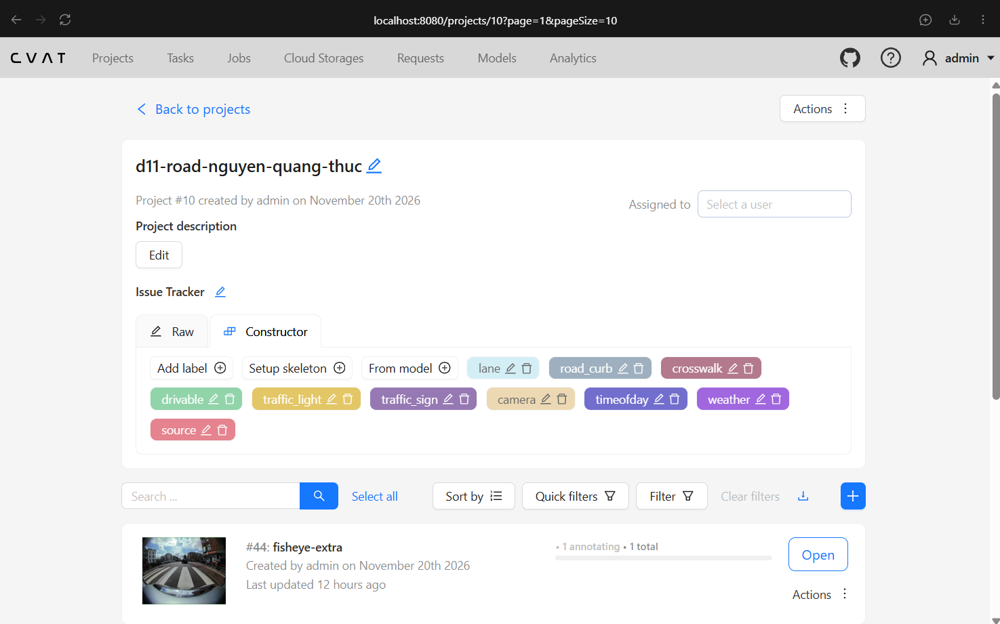
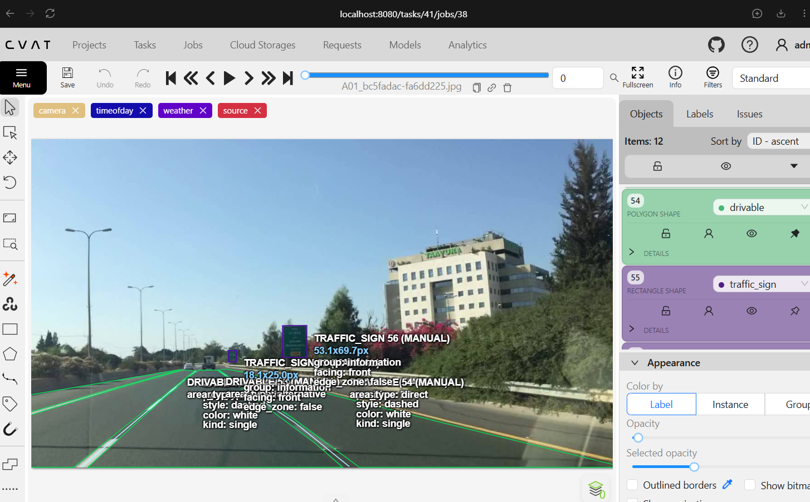
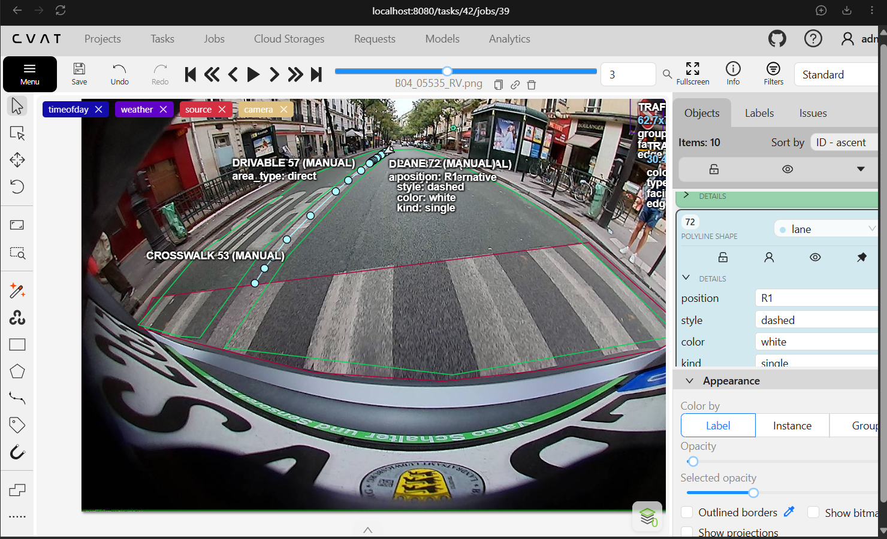
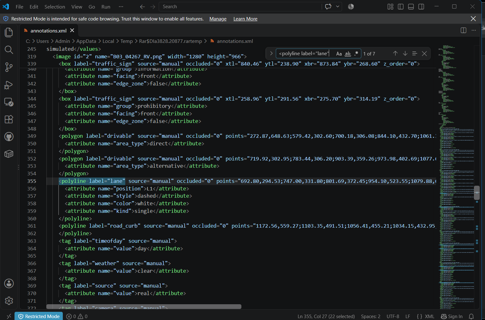

# Báo cáo cá nhân — Ngày 11

Họ tên: Nguyễn Quang Thức  
Mã học viên: 2A202603116  
Phiên bản CVAT (Help → About): Server/UI 2.82.0  
Guideline: Road v1.0    Lần nộp (`revision` trong manifest): 2  
Thời điểm export: 21/11/2026  
Số lần nộp lại sau Rework: 0

## 1. Kiểm project

| Mục | Đúng như guideline Road v1.0? | Ghi chú |
| --- | --- | --- |
| 6 label, đúng kiểu | Có | lane, road_curb, crosswalk, drivable, traffic_light, traffic_sign |
| Thuộc tính và giá trị | Có | Đã cấu hình theo `configs/road_v1_labels.json` |
| 4 tag ảnh | Có | camera, timeofday, weather, source |

Cách kết thúc polyline: vẽ từ gần xe ra xa; vạch đứt giữ trong một polyline.  
Cách đặt tag: mỗi ảnh có một tag camera, timeofday, weather và source.

## 2. Số lượng đã gán

| Task | Ảnh | lane | road_curb | crosswalk | drivable | traffic_light | traffic_sign |
| --- | ---: | ---: | ---: | ---: | ---: | ---: | ---: |
| front | 12 | 29 | 4 | 3 | 24 | 40 | 36 |
| front-extra (đã gộp vào front.zip) | 4 | 7 | 1 | 2 | 9 | 13 | 14 |
| fisheye | 8 | 7 | 4 | 7 | 10 | 7 | 4 |
| fisheye-extra (đã gộp vào fisheye.zip) | 4 | 0 | 2 | 4 | 4 | 0 | 0 |

## 3. Bảng ca khó

| Ảnh | Nhãn | Phân vân giữa | Đã chọn | Lý do |
| --- | --- | --- | --- | --- |
| A03 | lane | chiều vẽ | gần → xa | Quy tắc polyline của Road v1.0 |
| A06 | lane | vạch đứt có bị tách | một polyline | Không tách cùng một vạch |
| B06–B08 | lane | position thông thường / other | other | Camera hai bên |
| B02/B04 | traffic_light/traffic_sign | edge_zone bật/tắt | kiểm theo vị trí tâm box | Theo ngưỡng mép ảnh |

## 4. Phiếu QC 1 nhận được

Bạn kiểm lô của tôi: [CẦN ĐIỀN]  
Quyết định nhận được: [CẦN ĐIỀN]

| Mã lỗi | Số lỗi | Đồng ý? | Đã sửa? |
| --- | ---: | --- | --- |
| QC1-01 | [ ] | [ ] | [ ] |
| QC1-02 | [ ] | [ ] | [ ] |
| QC1-03 | [ ] | [ ] | [ ] |
| QC1-04 | [ ] | [ ] | [ ] |
| QC1-05 | [ ] | [ ] | [ ] |
| QC1-06 | [ ] | [ ] | [ ] |
| QC1-07 | [ ] | [ ] | [ ] |
| QC1-08 | [ ] | [ ] | [ ] |
| QC1-09 | [ ] | [ ] | [ ] |
| QC1-10 | [ ] | [ ] | [ ] |
| QC1-11 | [ ] | [ ] | [ ] |
| QC1-12 | [ ] | [ ] | [ ] |

## 5. Kiểm file export

| File | Mở lại được? | Số ảnh | Tag camera có trong XML? |
| --- | --- | ---: | --- |
| `nguyenquangthuc-front.zip` | Có | 16 | Có |
| `nguyenquangthuc-fisheye.zip` | Có | 12 | Có |

Lint sau khi gộp: 28 ảnh, 0 lỗi mức nặng, 0 lỗi chính và 1 cảnh báo nhẹ (A03 traffic light dưới 8 px; không bắt buộc).

## 6. Ảnh chụp màn hình

Đã bổ sung đủ 4 ảnh minh chứng:

## 7. Tự đánh giá

Lỗi cần chú ý nhất là chiều polyline và việc tách vạch đứt thành nhiều polyline. Nếu chiều hoặc hình học lane sai, model học sai hướng và vị trí tâm làn, có thể ảnh hưởng đến LKA/lane detection.
